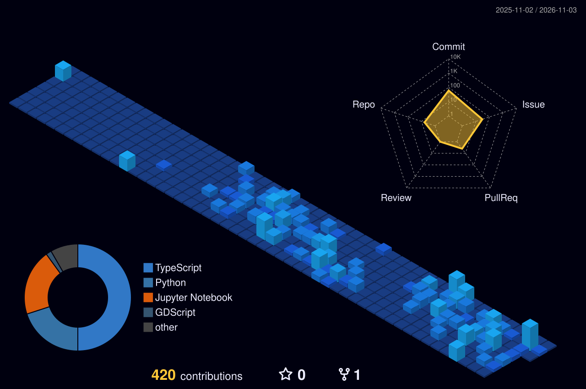

  

  

 

Estudante de **Ciência de Dados e IA** na UFPB, movido pela resolução de problemas.

- Pesquisador no **LIM** e no **TRIL**
- Diretor de Automação na **CortechX**
- Orquestração de **pipelines agentísticos** e **RAG com LLMs**
- Construção de sistemas de **Machine Learning** de alto impacto

 

  

 

  

  

 

<!-- MÉTRICAS: mesmos arquivos de antes, sem alteração -->

 

 

  

