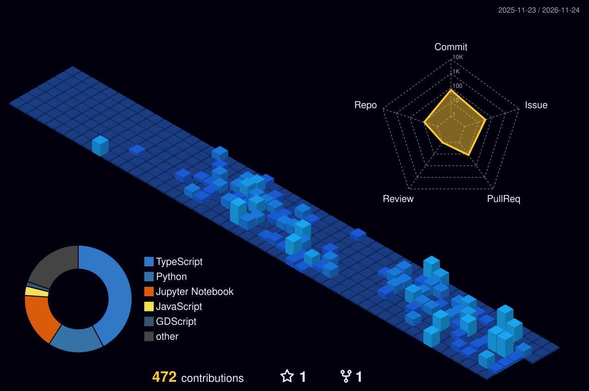
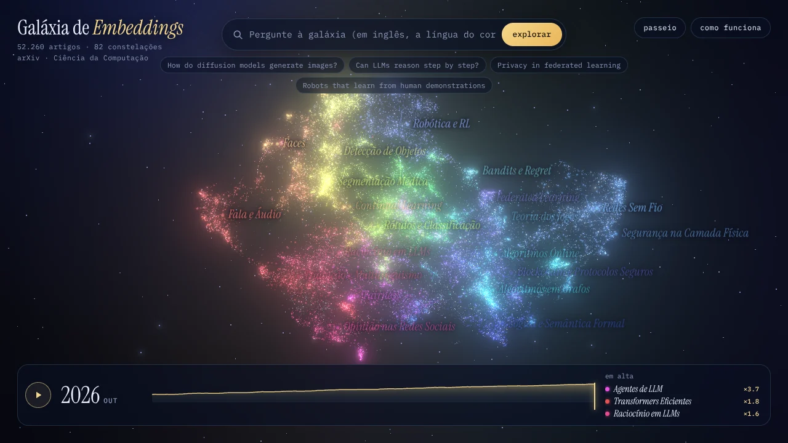

  

  

 

Estudante de **Ciência de Dados e IA** na UFPB, movido pela resolução de problemas.

- Pesquisador no **LIM** e no **TRIL**
- Diretor de Automação na **CortechX**
- Orquestração de **pipelines agentísticos** e **RAG com LLMs**
- Construção de sistemas de **Machine Learning** de alto impacto

 

  

 

  

  

 

<!-- MÉTRICAS: mesmos arquivos de antes, sem alteração -->

 

 

  

 

Um **mapa 3D do conhecimento**: 52 mil artigos do arXiv viram estrelas, os temas viram constelações batizadas por um LLM, e cada pergunta cai no espaço como uma estrela nova enquanto um **RAG** responde com as vizinhas. Embeddings, UMAP, HDBSCAN e busca semântica rodando no navegador.

**[Ver o projeto →](https://github.com/Gusttavoafonso/Galaxia-de-embeddings)**

 

  

